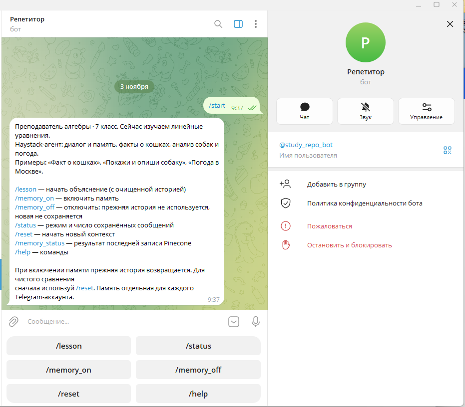
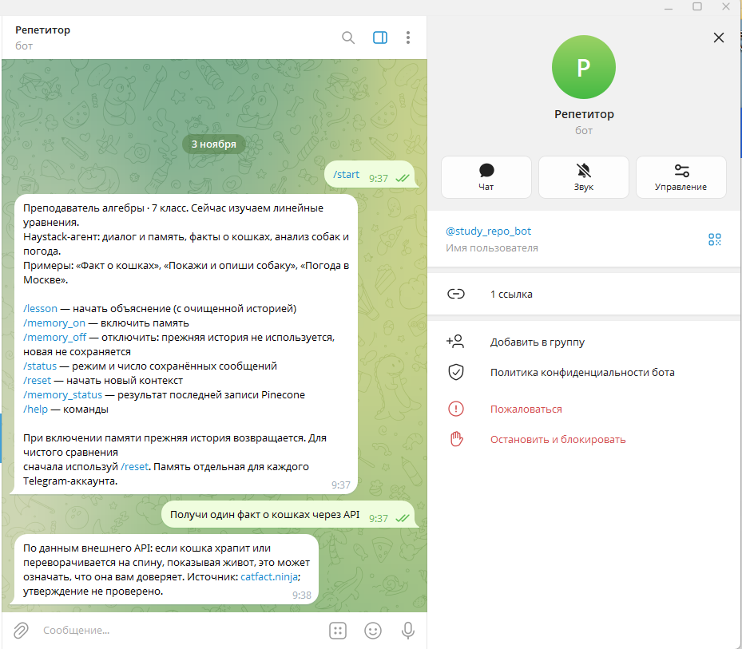
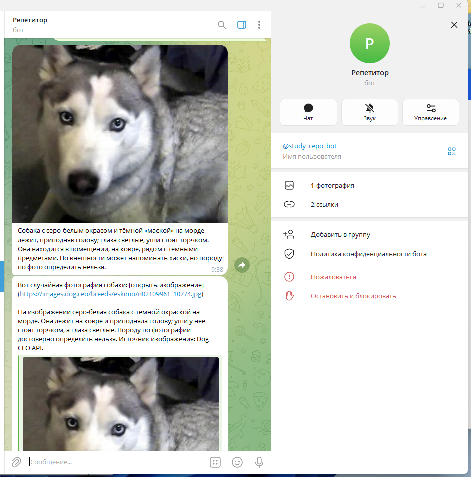
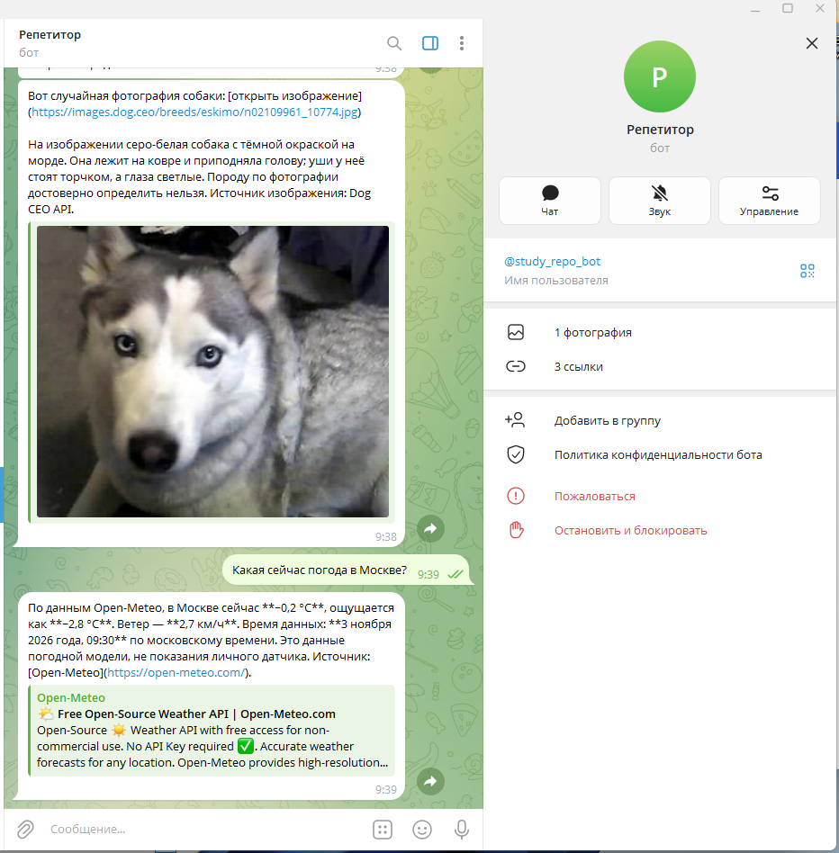
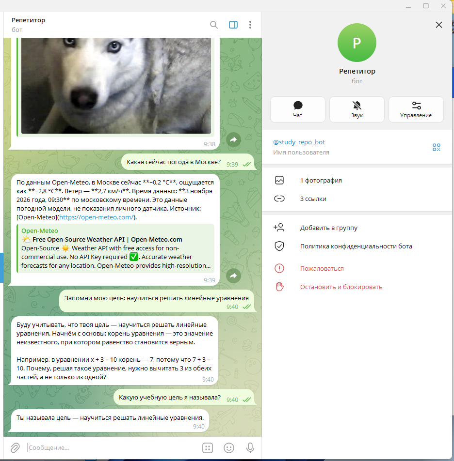

# Отчёт по заданию VPg06 — персональный ассистент на Haystack

## Задание

Создать новый инструмент для Haystack-агента, описать его в системном
промпте, сохранять в Pinecone только исходные сообщения пользователя
и проверить ответы по памяти. Проверить факт о кошках, анализ изображения
собаки и погоду через новый инструмент.

## Реализация

Создан Telegram-бот на **Haystack Agent**. OpenAIChatGenerator использует
модель gpt-6-luna через настраиваемый OPENAI_BASE_URL. Короткий диалог
хранится в SQLite, прежние сообщения пользователя — в Pinecone.

Добавлены инструменты get_cat_fact, analyze_dog_image и новый
**get_weather(city)**. Промпт задаёт случаи их вызова, требует использовать
реальный результат и явно сообщать об ошибках. Результаты внешних сервисов
не сохраняются как пользовательские факты.

## Запуск в Telegram

Команда /start показывает возможности Haystack-агента и примеры запросов.

## Факт о кошках

Запрос: «Получи один факт о кошках через API».
Haystack вызвал get_cat_fact, выполнивший GET к catfact.ninja/fact.
Поле fact проверено на наличие непустого текста.

Ответ агента при автоматической проверке:

> По данным внешнего API: утверждается, что кошки проводят во сне 70% своей жизни. Источник: catfact.ninja; утверждение не проверено независимо.

Утверждение приписано API; оно не выдаётся за независимо проверенный факт.

При отдельной проверке в Telegram API вернул другое случайное утверждение.
Бот также указал источник и отсутствие независимой проверки.

## Анализ изображения собаки

Запрос: «Покажи случайную собаку и опиши, что видно на изображении».
Агент вызвал analyze_dog_image. Инструмент получил URL через Dog CEO,
загрузил и проверил изображение, передал его байты через ImageContent
в vision-модель. Название породы из URL модели не передавалось.

В автоматической проверке обработан **image/jpeg**, размер **10738 байт**.

Описание vision-модели:

> На земле лежит собака с густой кудрявой шерстью тёмного, почти чёрного окраса; она вытянула передние лапы и высунула язык. Вокруг — трава с сухими листьями и участками голой земли. По фото породу определить нельзя, хотя внешне собака может напоминать пуделя или метиса.

Порода не объявлена достоверно определённой. Telegram-интерфейс отправляет
само изображение и описание; если Telegram не может получить картинку,
бот сообщает об этом и оставляет текст и ссылку.

В Telegram получена другая случайная фотография: серо-белая собака
со светлыми глазами. Бот отправил изображение, описал окрас, позу
и окружение; предположение о породе обозначил как неуверенное.

## Новый инструмент погоды

Запрос: «Какая сейчас погода в Москве?».
Haystack вызвал get_weather с аргументом city=Москва. Инструмент
получил координаты через геокодер и выполнил GET к Open-Meteo.

| Параметр | Значение при автоматической проверке |
|---|---|
| Город | Москва, Россия |
| Время данных | 2026-11-03T07:45, Europe/Moscow |
| Температура | -0.4 °C |
| Ощущаемая температура | -3.1 °C |
| Ветер | 4.0 км/ч |
| Источник | Open-Meteo |

Агент передал значения с единицами, городом, временем и источником.
Это данные погодной модели сервиса на момент запроса.

В Telegram инструмент повторно получил погоду: для Москвы на 09:30
3 ноября 2026 года — −0,2 °C, ощущается как −2,8 °C, ветер 2,7 км/ч.
Значения относятся к более позднему запросу, чем таблица выше.

## Проверка памяти Pinecone

Сохранено исходное сообщение: «Запомни мою цель: на этой неделе научиться
решать линейные уравнения». Затем короткая история очищена, и задан вопрос
о прежней цели.

Ответ Haystack-агента после поиска в Pinecone:

> Ты называла цель на эту неделю: научиться решать линейные уравнения.

В Pinecone сохраняется только оригинальный текст пользователя
с type=user_message. Ответы модели, содержимое инструментов и служебные
команды исключены. Пользователи разделены namespace и фильтром user_id.

В Telegram также проверен диалог: после сообщения о цели
«научиться решать линейные уравнения» бот правильно ответил на вопрос
«Какую учебную цель я называла?». Короткая история в этом ручном
сценарии не очищалась; проверка именно долгой памяти выполнена отдельно выше.

## Проверки

Пройдено **14 автоматических тестов** с подменой внешних сервисов:
память и фильтрация повторов, изоляция пользователей, сброс, исключение
служебных данных, пустые ответы API, корректность погоды и единиц,
неверное изображение, ограничения адресов и сетевые ошибки.

Отдельные реальные вызовы подтвердили работу Haystack Agent, всех трёх
инструментов, передачу изображения модели и восстановление цели из Pinecone.

## Вывод

Haystack-агент выбирает инструменты по запросу, получает реальные внешние
данные и использует сохранённый пользовательский контекст. Новый инструмент
погоды подключён к агенту и описан в промпте. Долгая память не смешивает
сообщения ученицы с ответами модели и результатами API.
